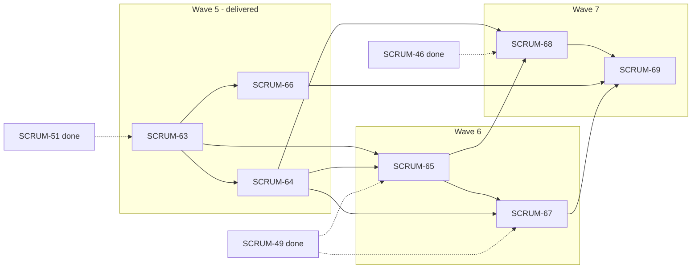

# Launchly interview practice wave plan

Source: Jira check of 2026-11-13 against `origin/main`. Wave 5 was delivered in PR #33 (merge commit `a02e7bf`); this version of the plan checks Waves 6 and 7 against that `main`.
Input for the `implement-bunch-ticket` skill: run one wave at a time, e.g. `implement-bunch-ticket docs/plans/interview-practice-wave-plan.md "Wave 6"`.
Wave numbers continue from `docs/plans/mvp-wave-plan.md` (Waves 0–4) so the `specs/wave-<n>-<slug>/` directories and `feat/wave-<n>-<slug>` branches stay unique.

## Goal

Replace the mock interview demo with real, text-only, job-linked interview practice (C-07 Interview Demonstration):

candidate picks a published job → gives interview AI consent → starts or resumes practice → answers five AI-generated questions per supported round → gets advisory round feedback and an overall summary → sees the completed session in history. Incomplete sessions expire after 24 hours of inactivity.

## Status

| Wave | Tickets | State |
| --- | --- | --- |
| 5 | SCRUM-63, 64, 66 | **Delivered** and Done (PR #33, `a02e7bf`, 2026-11-13) |
| 6 | SCRUM-65, 67 | To Do, no label, unassigned. Ready to run after the checks below. |
| 7 | SCRUM-68, 69 | To Do, no label, unassigned. Starts after Wave 6 is merged. |

## Entry gate

- **PO re-scope.** `mvp-wave-plan.md` keeps SCRUM-63 to 69 out of the MVP ("interview simulation", "extra AI features") until the PO re-scopes. Wave 5 ran on that confirmation; each later wave asks again at its approval gate.
- **Labels.** SCRUM-65, 67, 68 and 69 still have no delivery label in Jira. Each needs exactly one; this plan assumes `feature` for all four (the Wave 5 tickets got it at the approval gate).
- **Stale ticket text.** The Wave 6 and 7 ticket bodies were written against `db/SCRUM-35-db-design-init-script` at `95fe29b`, not `main`. See "Ticket text to correct" below; each wave's clarification round re-checks them.
- **Spec Kit mode.** Under Wave delivery each wave writes `specs/wave-<n>-<slug>/plan.md`, not the shared `specs/002-interview-practice/` the tickets ask for. Docs go in `docs/Interview-Practice.md`.
- **Coverage gate.** `pnpm coverage:changed` does not exist on `main`. Read the changed files from each package's `coverage/coverage-summary.json` after `pnpm test:coverage` (Wave 5 did this; every changed file was at or above 80% lines and branches) and record the method.

## Format rules (read by the skill)

- Each wave is a `## Wave <n> — <title>` section with one ticket table.
- Table columns: `Key | Ticket | Area | Label | Pts | Depends on`.
- `Depends on` lists Jira keys that must be merged into `main` before the ticket starts; `—` means none. A key from the **same wave** is built earlier in that wave (build order), not required to be merged first.
- Ticket content (user story, scope, acceptance criteria) lives in Jira; this file only groups and orders.

## What Wave 5 left on `main`

- **Model:** `InterviewSession` (candidate, job, optional application, `scope` `FULL`/`ROUND`, `interviewConsentAt`, `lastActivityAt`, `expiresAt`, `summary`), `InterviewPracticeRound` (`stageId`, `name`, `position`, `status`, `feedback`), `InterviewPracticeQuestion` (`prompt`, `position`, `source`), `InterviewPracticeAnswer` (`answer`, `feedback`, `score`). Unique keys on `(sessionId, position)`, `(roundId, position)` and `questionId`.
- **API:** candidate-only `/candidates/me/interview-practice`: `POST /` start (creates the rounds, no questions yet), `GET /:id` resume (resets the 24 h clock, expired sessions are `404`), `GET /` paginated history. Service in `apps/api/src/modules/interview-practice/interview-practice.service.ts` (`practiceExpiry`, `isPracticeExpired`).
- **Shared:** `packages/shared/src/schemas/interview-practice.ts` (session, round, question, answer, history DTOs) and `constants/interview-practice.ts` (`PRACTICE_QUESTIONS_PER_ROUND = 5`, `PRACTICE_EXPIRY_HOURS = 24`, `isInteractiveRoundFormat`).
- **Cleanup:** hourly in-process sweep (`interview-practice.cleanup.ts`), `PRACTICE_CLEANUP_ENABLED`.
- **A round is interactive** when its stage `format` is `ONLINE` or `PHONE`. There is no `roundType` (decision of 2026-11-12, SCRUM-51 comment). Any ticket text about stage `mode`, `roundType` or `durationMinutes` is stale.
- **e2e:** `apps/web/e2e/scrum-64-interview-practice.spec.ts` (API-level), reset commands `practice` and `practice-expire` in `apps/api/prisma/e2e-reset.ts`, helpers in `apps/web/e2e/helpers/db.ts`.

## Wave 5 — Practice sessions foundation

Delivered (PR #33). Kept here so the dependency columns below stay valid.

| Key | Ticket | Area | Label | Pts | Depends on |
| --- | --- | --- | --- | --- | --- |
| SCRUM-63 | Persist job-linked interview practice sessions | db, shared | feature | 3 | — |
| SCRUM-64 | Start and resume interview practice (candidate API under `modules/interview-practice/`, paginated history endpoint, interview AI consent) | api, shared | feature | 3 | SCRUM-63 |
| SCRUM-66 | Expire and delete incomplete practice sessions (24 h inactivity, in-process cleanup, completed history kept) | api | feature | 3 | SCRUM-63 |

In-wave total: 9 pts.

## Wave 6 — AI questions and feedback

Build order: SCRUM-65, then SCRUM-67.

- Both use the swappable AI provider (`getAiProvider()`, `generateJson({ prompt, system, schema })`, mock driver in tests) and validate AI output with a shared Zod schema before saving it. The mock driver returns the smallest valid value for the schema, so a question schema with `.length(5)` gives five placeholder strings: tests assert counts and shapes, not wording.
- **Timeout.** The 30 s timeout that turns a slow provider into `AppError('AI_UNAVAILABLE')` lives only in the assessment service (`ASSESSMENT_TIMEOUT_MS`). Wave 6 should reuse it, not copy it.
- **One limiter** for both routes, built with the existing `express-rate-limit` (see `middlewares/auth-rate-limit.ts`), keyed by the authenticated candidate and answering `RATE_LIMITED` (`429`) in the standard error shape: 10 requests per 60 s across question and feedback generation. It is process-local; document that a shared store is needed before running more than one API instance.
- **Routes** (proposal, all under `/candidates/me/interview-practice`, all owner-checked and consent-checked, all extend the 24 h clock like resume does):
  - `POST /:id/rounds/:roundId/questions` generates the five questions once; a repeat returns the stored set and calls no AI.
  - `PUT /:id/questions/:questionId/answer` saves or updates one text answer.
  - `POST /:id/rounds/:roundId/feedback` needs all five answers, stores the round feedback and completes the round; when the last selected round completes it also stores the overall summary and completes the session (`COMPLETED`, `completedAt`).
- **Idempotency:** the unique keys `(roundId, position)` and `questionId` already prevent duplicates; generate inside a transaction that locks the round row, and call the AI only when the round has no questions.
- **No numeric score anywhere (SCRUM-67).** Wave 5 left a placeholder `score` on `InterviewPracticeAnswer` and in the shared `practiceAnswerSchema`. SCRUM-67 removes `score` from the DTO and drops the column in a new forward migration (the legacy `InterviewAnswer.score` is a different table and stays).
- Ticket text to correct: see below.

| Key | Ticket | Area | Label | Pts | Depends on |
| --- | --- | --- | --- | --- | --- |
| SCRUM-65 | Generate and save text-only practice rounds (five questions per supported round, idempotent retries, shared AI limiter) | api, shared | feature | 3 | SCRUM-63, SCRUM-64 |
| SCRUM-67 | Generate round feedback and an overall practice summary | api, shared | feature | 3 | SCRUM-64, SCRUM-65 |

In-wave total: 6 pts.

### Wave 6 questions for the clarification round (recommended defaults)

1. **Where do prompts get their input?** Default: only the job title, description, requirements and the round name and format. Never the CV, profile or application.
2. **Source label values.** Default: a short fixed set in `@launchly/shared` (for example `JOB_DESCRIPTION`, `JOB_REQUIREMENTS`, `ROUND_PROCESS`) chosen by the model per question and validated by the schema, shown to candidates as readable text.
3. **How is structured feedback stored?** Default: validated JSON text in the existing `feedback` and `summary` columns, parsed with the shared schema on read, no type-changing migration. The only migration is dropping `score`.
4. **Disclaimer.** Default: one shared constant `PRACTICE_FEEDBACK_DISCLAIMER` with the exact SCRUM-69 text, returned inside the feedback and summary DTOs so the web never retypes it.
5. **Feedback timing.** Default: allowed only when all five answers of the round are saved; otherwise `400`.
6. **Retry after a provider failure.** Default: nothing is stored; the same call can be repeated and counts toward the limiter.
7. **Timeout helper.** Default: extract the existing timeout wrapper into `providers/ai` and use it from both modules.

## Wave 7 — Practice UI and history

Build order: SCRUM-68, then SCRUM-69.

- SCRUM-68 replaces the mock UI. Today `apps/web/src/app/(main)/interview-practice/page.tsx` renders `SessionBar`, `ConversationPanel`, `FeedbackPanel` and `SessionFooter` from a static `mock-interview-session.ts` (voice, countdown timer, score, percentile, verdict). Delete what nothing imports afterwards: `waveform.tsx`, `countdown-timer.tsx`, the score and verdict parts of `feedback-panel.tsx`, `mock-interview-session.ts`, and `session-bar.tsx`, `session-footer.tsx`, `conversation-panel.tsx`, `rich-text.tsx`, `action-button.ts` if they are replaced.
- Entry points that already link to `/interview-practice` and must keep working: the main nav (`main-nav.tsx`), the footer and the landing feature grid. Only the footer label ("Phòng luyện phỏng vấn giả lập AI") calls it a simulation; the nav ("Luyện phỏng vấn AI") and the landing card ("Luyện phỏng vấn với AI") do not.
- Web calls the API through `apps/web/src/lib/api/*.ts` (add `interview-practice.ts` next to `assessments.ts`) with the shared schemas; use the existing `/api` rewrite and design tokens from `docs/Frontend-Conventions.md`.
- SCRUM-69 shows the disclaimer from the shared constant (exact SCRUM-69 text) and offers resume only for unexpired incomplete sessions; the server is the source of truth.
- **Playwright** (the SCRUM-46 harness is merged): spec files are `apps/web/e2e/scrum-<n>-<slug>.spec.ts` with one `test()` per AC titled `AC<k>: …`, not `interview-practice.spec.ts` as the ticket text says. Candidate `candidate1@launchly.test` already owns one completed seeded session. Reuse the `practice` and `practice-expire` reset commands. The API runs with `AI_DRIVER=mock`, so questions are placeholders; assert five items, not text.

| Key | Ticket | Area | Label | Pts | Depends on |
| --- | --- | --- | --- | --- | --- |
| SCRUM-68 | Replace the mock interview demo with text-only practice | web | feature | 3 | SCRUM-64, SCRUM-65 |
| SCRUM-69 | Show interview practice history and feedback | web | feature | 3 | SCRUM-66, SCRUM-67, SCRUM-68 |

In-wave total: 6 pts.

### Wave 7 questions for the clarification round (recommended defaults)

1. **How does a candidate pick a job?** Default: a "Practice this interview" link on the public job detail page opens `/interview-practice?jobId=…`; the practice page itself also lists recent published jobs with search. No new job picker API.
2. **Where does history live?** Default: a "History" tab on `/interview-practice`, not a new top-level route.
3. **One page or several?** Default: `/interview-practice` (start and history) and `/interview-practice/[id]` (active round, then results), so reload and resume use the URL.
4. **Mobile.** Default: single column from 360 px, tested at phone width in e2e.
5. **Nav copy.** Default: keep the nav and the landing card as they are and change only the footer label, dropping "giả lập" (simulation), since the feature is no longer a mock.
6. **Wave 7 needs Wave 6 merged first.** Default: yes, run it only after the Wave 6 PR is merged.

## Ticket text to correct

Apply these edits to the Jira tickets at each wave's approval gate (as was done for SCRUM-63, 64 and 66), not silently:

- **All four (65, 67, 68, 69):** "SCRUM-49, SCRUM-51 and SCRUM-46 are To Do" is wrong; all three are Done and merged. Remove the `db/SCRUM-35` snapshot notes and the Spec Kit (`specs/002-interview-practice/`) instructions; the wave plan replaces them. Replace the "300 handwritten lines" criterion with the Wave delivery rule (report the size, split only on request).
- **SCRUM-65 and 67:** stage `mode`/`roundType`/`durationMinutes` do not exist; interactive means format `ONLINE` or `PHONE`. SCRUM-65's AI timeout is not in the provider; see the Wave 6 notes. SCRUM-67's mention of "score" in the old model: the practice score column is removed there.
- **SCRUM-68 and 69:** `apps/web/e2e/interview-practice.spec.ts` and `interview-practice-history.spec.ts` should be named `scrum-68-…` and `scrum-69-…`; the harness is merged, so "a missing SCRUM-46 setup is a blocker" no longer applies.

## Total

21 pts across three waves; Wave 5 (9 pts) is done, 12 pts remain (about 3 dev-hours at ≤45 min per ticket).

## Dependency graph

Jira links match this graph (the SCRUM-51 → SCRUM-63 link was added on 2026-11-13).

## Cut lines if time runs short

1. Ship SCRUM-69 with history only and show feedback inline at the end of SCRUM-68's flow.
2. In Wave 6, if the limiter or timeout extraction runs long, ship SCRUM-65 first and merge it before SCRUM-67 (they are already built in that order).

## Jira housekeeping (done 2026-11-13)

Unassigned and stale items found by the Jira check of that day, cleaned up:

- Moved to Done: subtasks SCRUM-75 to 81 (parents merged), Stories SCRUM-57, 60, 82, 72, 73, 74 (merged on `main`), SCRUM-27 (superseded by 71–74), SCRUM-52 (decided), placeholders SCRUM-2, 3, 4, and now SCRUM-63, 64, 66 (Wave 5, with refined descriptions).
- Assigned subtasks SCRUM-86, 87, 88 to Sĩ, owner of their Stories SCRUM-83 to 85.
- Added the missing Jira link SCRUM-51 blocks SCRUM-63.
- Epics (SCRUM-5, 6, 7, 17, 18, 19, 20) stay without an assignee.
