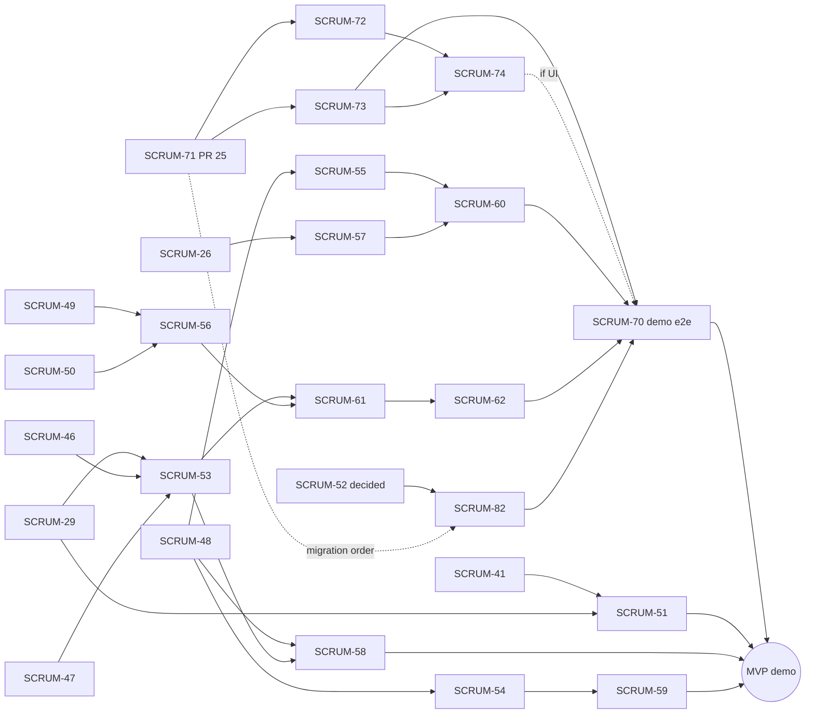

# Launchly MVP wave plan

Source: MVP re-scope of 2026-11-12 (User Stories v0.1 vs. code on `main`), 30 dev-hours for the whole team, 1-hour sprints, every ticket ≤ 45 min.
Input for the `implement-bunch-ticket` skill: run one wave at a time, e.g. `implement-bunch-ticket docs/plans/mvp-wave-plan.md "Wave 1"`.

## Goal

Demo loop that the MVP must show end to end:

post job with process → admin approves → candidate finds job → checks CV fit with AI → applies → recruiter changes status → candidate sees the new status.

## Budget

| Use | Hours |
| --- | --- |
| Wave 0: finish in-flight work | 8 |
| Waves 1–4: 16 new tickets | 16 |
| Buffer: review fixes, bugs, demo | 6 |
| **Total** | **30** |

## Format rules (read by the skill)

- Each wave is a `## Wave <n> — <title>` section with one ticket table.
- Table columns: `Key | Ticket | Area | Label | Pts | Depends on`.
- `Depends on` lists Jira keys that must be merged into `main` before the ticket starts; `—` means none. A key from the **same wave** is built earlier in that wave (build order), not required to be merged first.
- Ticket content (user story, scope, acceptance criteria) lives in Jira; this file only groups and orders.

## Wave 0 — Finish in-flight work

Delivered with the normal single-ticket flow, not by `implement-bunch-ticket`. SCRUM-41 and SCRUM-29 moved to Wave 1 on 2026-11-12: no implementation of them exists on GitHub (no PR, no pushed code branch).

Status on 2026-11-13: SCRUM-26 is Done (PR #23 merged). SCRUM-27 was split into SCRUM-71 to 74 (see "Outside the wave run") and is **owned outside the wave work**; the Wave 4 run does not depend on it, but the demo e2e does. SCRUM-52 was decided on 2026-11-13 (option a, delivered by SCRUM-82).

| Key | Ticket | Area | Label | Pts | Depends on |
| --- | --- | --- | --- | --- | --- |
| SCRUM-26 | Post a job with process and notes (subtasks 39, 40, 42, 44, 45; SCRUM-43 deferred) | api, web, db | feature | — | — |
| SCRUM-27 | Approve companies and jobs | api, web | feature | — | — |
| SCRUM-52 | PO decision: job levels Intern/Fresher/Junior (15 min, no dev slot) | — | clarification | 1 | — |

## Wave 1 — Foundations

Status: **Done**, merged in PR #21 (2026-11-12). SCRUM-43 stays deferred.

| Key | Ticket | Area | Label | Pts | Depends on |
| --- | --- | --- | --- | --- | --- |
| SCRUM-46 | Set up Playwright e2e with a smoke test (build first in this wave) | web | maintenance | 3 | — |
| SCRUM-41 | Process rounds builder for job postings (10 commits exist on local branch `feat/SCRUM-41-process-rounds-builder`, not on GitHub: reuse them, then finish and test) | shared, api, web, db | feature | 2 | — |
| SCRUM-29 | View hiring process and company notes (only spec `docs/SCRUM-29-job-detail-process-notes-plan` is on GitHub; implement it) | api, shared, web, db | feature | 3 | SCRUM-41 |
| SCRUM-48 | Candidate applies to a job via API | api, shared, db | feature | 3 | — |
| SCRUM-49 | Swappable AI provider with a mock driver | api | feature | 3 | — |
| SCRUM-50 | Extract text from uploaded PDF CVs (PDF only, Vietnamese and English; DOCX dropped, so a DOCX upload must give a clear "export as text-based PDF" error) | api | feature | 3 | — |
| SCRUM-51 | Show format and duration for each hiring round (SCRUM-41's migration already adds `format` and `estimatedDurationMinutes` to `JobStage`; reuse them, add only what is missing) | api, shared, web, db | feature | 2 | SCRUM-41, SCRUM-29 |

## Wave 2 — Core APIs and entry pages

Status: **Done**, merged in PR #22 (2026-11-13).

| Key | Ticket | Area | Label | Pts | Depends on |
| --- | --- | --- | --- | --- | --- |
| SCRUM-47 | Return full job details from the public job detail API (stages with format and duration already come from SCRUM-29; add requirements, benefits, industry, createdAt, company summary) | api, shared | feature | 2 | SCRUM-29 |
| SCRUM-53 | Job detail page for candidates | web | feature | 3 | SCRUM-46, SCRUM-47, SCRUM-29 |
| SCRUM-54 | Candidate lists own applications with status history via API | api, shared | feature | 2 | SCRUM-48 |
| SCRUM-55 | Recruiter lists applicants and changes their status via API (backend only; must document the endpoint contract for SCRUM-60) | api, shared | feature | 3 | SCRUM-48 |
| SCRUM-56 | AI scores how well a CV matches a job description | api, shared | feature | 3 | SCRUM-49, SCRUM-50 |

## Wave 3 — User-facing flows

Status: **Done**, merged in PR #24 (2026-11-13).

| Key | Ticket | Area | Label | Pts | Depends on |
| --- | --- | --- | --- | --- | --- |
| SCRUM-58 | Candidate applies from the job detail page | web | feature | 3 | SCRUM-48, SCRUM-53 |
| SCRUM-59 | Replace mock My Applications page with real status tracking | web | feature | 3 | SCRUM-54 |
| SCRUM-61 | CV fit check on the CV review page with AI consent | api, web, db | feature | 3 | SCRUM-56, SCRUM-53 |

## Wave 4 — Finish and demo

Status (2026-11-13): all tickets To Do. The `implement-bunch-ticket` run covers only the three tickets below, all owned by Sơn, on branch `feat/wave-4-recruiter-applicants` from a fresh `origin/main`. Everything else that has to land before the demo is listed under "Outside the wave run" and delivered by its own owner.

Build order: SCRUM-57, then SCRUM-60, then SCRUM-82.

- SCRUM-57 (moved from Wave 2 on 2026-11-13: its dependency SCRUM-26 was still In Progress at the time, now merged) has no other open dependency.
- SCRUM-60 depends on SCRUM-57 (built first on the same branch) and consumes the SCRUM-55 API contract in `docs/api/recruiter-applications.md` as-is. Its AC can check the candidate view because SCRUM-59 is merged.
- SCRUM-82 is built **last and only after PR #25 (SCRUM-71) is merged**: #25 adds migration `20261113061731_moderation_review_audit` and edits `schema.prisma`, and SCRUM-82 also needs a new migration on `schema.prisma`. If #25 is still open when 57 and 60 are done, ship them in the wave PR and move SCRUM-82 to its own `maintenance` PR (no Spec Kit, no coverage gate) once #25 merges.
- Gates: `pn test:coverage` and `pn coverage:changed` do not exist on `main` (`chore/test-coverage` is unmerged, api only). Under the Wave delivery exception the run records them as "not available"; typecheck, lint, test and Playwright e2e must be green.

| Key | Ticket | Area | Label | Pts | Depends on |
| --- | --- | --- | --- | --- | --- |
| SCRUM-57 | Recruiter sees own jobs with applicant counts (re-estimated 2 → 3 pts on 2026-11-13: SCRUM-26 ships no recruiter job list, so `GET /recruiter/jobs`, shared schema and the My jobs page are all new; the "View applicants" link targets `/recruiter/jobs/[id]/applicants`, built in SCRUM-60) | api, shared, web | feature | 3 | SCRUM-26 |
| SCRUM-60 | Recruiter reviews applicants and updates their status (frontend only; consumes the SCRUM-55 API as-is; creates the `/recruiter/jobs/[id]/applicants` route; e2e: recruiter moves an applicant to Interview, candidate sees it in My Applications) | web | feature | 3 | SCRUM-55, SCRUM-57 |
| SCRUM-82 | Replace job level SENIOR with JUNIOR (PO decision (a) on SCRUM-52; new migration that remaps SENIOR rows and recreates the enum, never edit the committed one; touches `schema.prisma`, `packages/shared` `JOB_LEVELS`, seed, job test, web label and filter; must land before SCRUM-70) | db, shared, api, web | maintenance | 2 | SCRUM-52, PR #25 merged |

In-wave total: 8 pts.

## Outside the wave run (Wave 4 companions)

Not read by `implement-bunch-ticket`: it takes only the table under "Wave 4". These tickets are delivered by their owners with the single-ticket flow, in parallel with the wave. Assignees as of 2026-11-13.

| Key | Ticket | Owner | Pts | Depends on | Note |
| --- | --- | --- | --- | --- | --- |
| SCRUM-62 | Add score band and advisory note to the CV fit result (shrunk 3 → 1 pt on 2026-11-13: SCRUM-61 already ships `fit-result.tsx`; only band label, advisory note and text-readable score are new) | Sĩ | 1 | SCRUM-61 | `feature` label: `implement-ticket` stops at the missing coverage gate, so the owner needs a person's go-ahead to record it as "not available". |
| SCRUM-71 | Admin approves or rejects companies (PR #25, CI green, awaiting review) | Dũng implements, Sơn assigned in Jira | — | — | Critical path: blocks 72 and 73. Merge before SCRUM-82. |
| SCRUM-72 | Admin moderation page for companies | Vinh | — | SCRUM-71 | |
| SCRUM-73 | Admin approves or rejects jobs (API, recruiter email) | Quý | — | SCRUM-71 | The demo step "admin approves the job" needs this at minimum. |
| SCRUM-74 | Jobs tab on the admin moderation page | Thiên | — | SCRUM-72, SCRUM-73 | Needed only if the demo e2e clicks through the admin UI. |
| SCRUM-70 | Full MVP demo loop as one Playwright scenario (`maintenance`, 1 h) | Thiên | — | SCRUM-57, 60, 62, 73 (74 if UI), 82 | Last ticket of the MVP. Jira text still says "SCRUM-27 merged": the real blockers are 73 and 74. Thiên also owns 74, so the two run in series. |

Sprint 3 ends 2026-11-14; everything above is in it, so expect carry-over into a new sprint.

## Dependency graph

SCRUM-46 (Playwright) is needed by every ticket that changes `apps/web`; only its edge to SCRUM-53 is drawn.

## Cut lines if time runs short

1. Drop SCRUM-51 and SCRUM-57 (−4 pts); recruiters reach applicants via a direct link. SCRUM-60 then needs the link from the demo script instead of the My jobs page.
2. Drop SCRUM-82 (−2 pts): keep `SENIOR` for the demo and run the migration after it. Cheapest cut, but it reverses the SCRUM-52 decision for now.
3. Drop SCRUM-74 (admin Jobs tab): the demo e2e approves the job through the SCRUM-73 API instead of the UI.
4. Keep SCRUM-43 deferred.

## Open items (2026-11-13)

- SCRUM-63 to SCRUM-69 (interview practice) exist in Jira but are out of the MVP ("interview simulation", "extra AI features" below). Keep them out of Wave 4 until the PO re-scopes.
- SCRUM-52 (job levels): decided 2026-11-13, option (a) replace `SENIOR` with `JUNIOR`. Delivered by SCRUM-82 (Wave 4).
- Admin moderation was split in Jira on 2026-11-13: SCRUM-27's work now sits under epic SCRUM-20 as SCRUM-71 (companies API, In Review as PR #25), SCRUM-72 (companies page), SCRUM-73 (jobs API), SCRUM-74 (jobs tab). SCRUM-72 to 74 carry the `mvp` label and are assigned (see "Outside the wave run"). SCRUM-27 itself still shows In Progress as the old parent: close or re-parent it in Jira.
- PR #25 (SCRUM-71) is open with CI green and no review yet. It blocks 72, 73 and SCRUM-82's migration, so reviewing and merging it is the critical path.
- Jira has no issue links for 57 → 60, 82 → 70 or SCRUM-70's blockers; those dependencies live only in this file.
- SCRUM-52 shows To Do although the decision is recorded in a comment: a person moves it to Done.
- `pn test:coverage` and `pn coverage:changed` still do not exist on `main`; `chore/test-coverage` (api only, no PR) is the starting point if a ticket is created for them.

## Removed from the MVP

LinkedIn login, structured profile sections, career preferences, default CV, CV builder, privacy settings, account deletion, extra search filters, saved jobs/searches, recommendations, reviews, job compare, company culture pages, notifications, withdraw, rejection feedback, interview scheduling, community/transparency extras, process templates, interview simulation, extra AI features, company verification documents, talent search, payments, multi-HR, admin reports/users/dashboard/catalog, i18n, responsive/a11y/perf passes. Full list with reasons: `.tmp/jira-issues/backlog-from-user-stories-2026-11-12.md` (local) and the Jira backlog.
