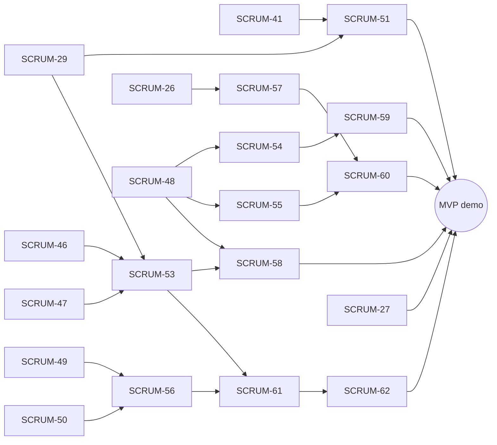

# Launchly MVP wave plan

Source: MVP re-scope of 2026-11-12 (User Stories v0.1 vs. code on `main`), 30 dev-hours for the whole team, 1-hour sprints, every ticket ≤ 45 min.
Input for the `implement-bunch-ticket` skill: run one wave at a time, e.g. `implement-bunch-ticket docs/plans/mvp-wave-plan.md "Wave 1"`.

## Goal

Demo loop that the MVP must show end to end:

post job with process → admin approves → candidate finds job → checks CV fit with AI → applies → recruiter changes status → candidate sees the new status.

## Budget

| Use | Hours |
| --- | --- |
| Wave 0: finish in-flight work | 8 |
| Waves 1–4: 16 new tickets | 16 |
| Buffer: review fixes, bugs, demo | 6 |
| **Total** | **30** |

## Format rules (read by the skill)

- Each wave is a `## Wave <n> — <title>` section with one ticket table.
- Table columns: `Key | Ticket | Area | Label | Pts | Depends on`.
- `Depends on` lists Jira keys that must be merged into `main` before the ticket starts; `—` means none. A key from the **same wave** is built earlier in that wave (build order), not required to be merged first.
- Ticket content (user story, scope, acceptance criteria) lives in Jira; this file only groups and orders.

## Wave 0 — Finish in-flight work

Delivered with the normal single-ticket flow, not by `implement-bunch-ticket`. SCRUM-41 and SCRUM-29 moved to Wave 1 on 2026-11-12: no implementation of them exists on GitHub (no PR, no pushed code branch).

| Key | Ticket | Area | Label | Pts | Depends on |
| --- | --- | --- | --- | --- | --- |
| SCRUM-26 | Post a job with process and notes (subtasks 39, 40, 42, 44, 45; SCRUM-43 deferred) | api, web, db | feature | — | — |
| SCRUM-27 | Approve companies and jobs | api, web | feature | — | — |
| SCRUM-52 | PO decision: job levels Intern/Fresher/Junior (15 min, no dev slot) | — | clarification | 1 | — |

## Wave 1 — Foundations

| Key | Ticket | Area | Label | Pts | Depends on |
| --- | --- | --- | --- | --- | --- |
| SCRUM-46 | Set up Playwright e2e with a smoke test (build first in this wave) | web | maintenance | 3 | — |
| SCRUM-41 | Process rounds builder for job postings (10 commits exist on local branch `feat/SCRUM-41-process-rounds-builder`, not on GitHub: reuse them, then finish and test) | shared, api, web, db | feature | 2 | — |
| SCRUM-29 | View hiring process and company notes (only spec `docs/SCRUM-29-job-detail-process-notes-plan` is on GitHub; implement it) | api, shared, web, db | feature | 3 | SCRUM-41 |
| SCRUM-48 | Candidate applies to a job via API | api, shared, db | feature | 3 | — |
| SCRUM-49 | Swappable AI provider with a mock driver | api | feature | 3 | — |
| SCRUM-50 | Extract text from uploaded PDF CVs (PDF only, Vietnamese and English; DOCX dropped, so a DOCX upload must give a clear "export as text-based PDF" error) | api | feature | 3 | — |
| SCRUM-51 | Show format and duration for each hiring round (SCRUM-41's migration already adds `format` and `estimatedDurationMinutes` to `JobStage`; reuse them, add only what is missing) | api, shared, web, db | feature | 2 | SCRUM-41, SCRUM-29 |

## Wave 2 — Core APIs and entry pages

| Key | Ticket | Area | Label | Pts | Depends on |
| --- | --- | --- | --- | --- | --- |
| SCRUM-47 | Return full job details from the public job detail API (stages with format and duration already come from SCRUM-29; add requirements, benefits, industry, createdAt, company summary) | api, shared | feature | 2 | SCRUM-29 |
| SCRUM-53 | Job detail page for candidates | web | feature | 3 | SCRUM-46, SCRUM-47, SCRUM-29 |
| SCRUM-54 | Candidate lists own applications with status history via API | api, shared | feature | 2 | SCRUM-48 |
| SCRUM-55 | Recruiter lists applicants and changes their status via API (backend only; must document the endpoint contract for SCRUM-60) | api, shared | feature | 3 | SCRUM-48 |
| SCRUM-56 | AI scores how well a CV matches a job description | api, shared | feature | 3 | SCRUM-49, SCRUM-50 |

## Wave 3 — User-facing flows

| Key | Ticket | Area | Label | Pts | Depends on |
| --- | --- | --- | --- | --- | --- |
| SCRUM-58 | Candidate applies from the job detail page | web | feature | 3 | SCRUM-48, SCRUM-53 |
| SCRUM-59 | Replace mock My Applications page with real status tracking | web | feature | 3 | SCRUM-54 |
| SCRUM-61 | CV fit check on the CV review page with AI consent | api, web, db | feature | 3 | SCRUM-56, SCRUM-53 |

## Wave 4 — Finish and demo

SCRUM-57 (moved from Wave 2 on 2026-11-13: its dependency SCRUM-26 was still In Progress) and SCRUM-60 (moved from Wave 3 because it depends on SCRUM-57) are built first, in this order.

| Key | Ticket | Area | Label | Pts | Depends on |
| --- | --- | --- | --- | --- | --- |
| SCRUM-57 | Recruiter sees own jobs with applicant counts | api, web | feature | 2 | SCRUM-26 |
| SCRUM-60 | Recruiter reviews applicants and updates their status (frontend only; consumes the SCRUM-55 API as-is, SCRUM-59 is built in Wave 3, so its AC can check the candidate view) | web | feature | 3 | SCRUM-55, SCRUM-57 |
| SCRUM-62 | Show CV fit results with score band, gaps and suggestions | web | feature | 3 | SCRUM-61 |

After Wave 4: run the full demo loop as one Playwright scenario and fix what breaks (buffer hours).

## Dependency graph

SCRUM-46 (Playwright) is needed by every ticket that changes `apps/web`; only its edge to SCRUM-53 is drawn.

## Cut lines if time runs short

1. Drop SCRUM-51 and SCRUM-57 (−4 pts); recruiters reach applicants via a direct link.
2. Keep SCRUM-43 deferred.

## Removed from the MVP

LinkedIn login, structured profile sections, career preferences, default CV, CV builder, privacy settings, account deletion, extra search filters, saved jobs/searches, recommendations, reviews, job compare, company culture pages, notifications, withdraw, rejection feedback, interview scheduling, community/transparency extras, process templates, interview simulation, extra AI features, company verification documents, talent search, payments, multi-HR, admin reports/users/dashboard/catalog, i18n, responsive/a11y/perf passes. Full list with reasons: `.tmp/jira-issues/backlog-from-user-stories-2026-11-12.md` (local) and the Jira backlog.
